<a href="https://shravankasar.vercel.app">
  
</a>

<p align="center">
  <a href="https://shravankasar.vercel.app"></a>
  <a href="https://www.linkedin.com/in/shravan-kasar-2445962a9"></a>
  <a href="https://huggingface.co/shravan37"></a>
  <a href="mailto:shravankasar001@gmail.com"></a>
  <a href="https://shravankasar.vercel.app/Shravan-Kasar-Resume.pdf"></a>
  
</p>



## ⚡ `about.me`

**From model training to paying customers, I build AI that ships.**

I'm a **B.Tech IT** student at **Pillai College of Engineering** and the founder of **[CaratCloud](https://caratcloudstorefront-idp6.vercel.app/)**. I design, train and deploy AI end to end: agentic RAG that cites the law correctly, a voice deepfake detector, a multilingual scam shield for Indian families, and SaaS that jewellers pay for every month.


## 🚀 `featured.builds`

<table>
  <tr>
    <td width="50%"><a href="https://github.com/shravankasar37/Kavach2.0"></a></td>
    <td width="50%"><a href="https://github.com/shravankasar37/-NyayaSathi"></a></td>
  </tr>
  <tr>
    <td width="50%"><a href="https://github.com/shravankasar37/VaaniShield2.0"></a></td>
    <td width="50%"><a href="https://github.com/shravankasar37/AriaSiH"></a></td>
  </tr>
  <tr>
    <td width="50%"><a href="https://github.com/shravankasar37/cyclone-dss"></a></td>
    <td width="50%"><a href="https://caratcloudstorefront-idp6.vercel.app/"></a></td>
  </tr>
</table>

<p align="center">
  <a href="https://kavach-2-0.vercel.app/">Kavach live</a> ·
  <a href="https://nyayasathi-xnmm.onrender.com/">NyayaSathi live</a> ·
  <a href="https://vaanishield-ai.vercel.app/">VaaniShield live</a> ·
  <a href="https://aria-workbench.onrender.com/">ARIA live</a> ·
  <a href="https://cyclone-dss.vercel.app/">TRINETRA live</a> ·
  <a href="https://shravankasar.vercel.app/#work"><b>all projects in detail →</b></a>
</p>


## 🧠 `tech.stack`


<p align="center">
  
</p>


## 💼 `experience.log`

```diff
+ Aug 2025 → now   Founder & Full-Stack Developer · CaratCloud
                   Jewellery ERP SaaS, built and sold solo
                   GST & HUID invoicing · gold loans · 5 shops on annual contracts

+ Jan → Jul 2025   AI Intern · AiSkool (Discover Technology)
                   AI & robotics curriculum (mBot, mRanger)
                   Python-to-robot projects · live demos at Science & AI fairs

+ Apr → May 2024   AI Developer Trainee · Acmegrade
                   Classification & regression models
                   Capstone recognised at IIT Bombay's Mood Indigo
```


## 📊 `github.activity`

<p align="center">
  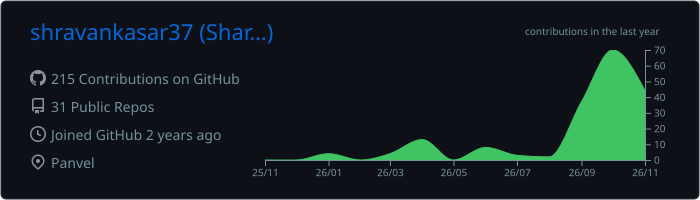
</p>

<p align="center">
  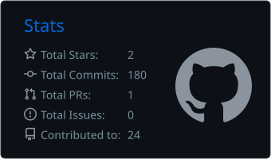
  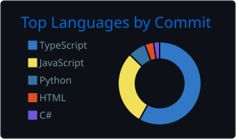
  
</p>

<p align="center">
  <picture>
    <source media="(prefers-color-scheme: dark)" srcset="https://raw.githubusercontent.com/shravankasar37/shravankasar37/output/github-snake-dark.svg"/>
    
  </picture>
</p>

<a href="https://shravankasar.vercel.app/#contact">
  
</a>
