<a href="https://shravankasar.vercel.app">
  
</a>

<p align="center">
  <a href="https://shravankasar.vercel.app"></a>
  <a href="https://www.linkedin.com/in/shravan-kasar-2445962a9"></a>
  <a href="https://huggingface.co/shravan37"></a>
  <a href="mailto:shravankasar001@gmail.com"></a>
  <a href="https://shravankasar.vercel.app/Shravan-Kasar-Resume.pdf"></a>
</p>

## `// a little about me`

**From model training to paying customers, I build AI that ships.**

I'm a **B.Tech Information Technology** student at **Pillai College of Engineering** and the founder of **[CaratCloud](https://caratcloudstorefront-idp6.vercel.app/)**. I design, train and deploy AI end to end: agentic RAG that cites the law correctly, a voice deepfake detector, a multilingual scam shield for Indian families, and SaaS that jewellers pay for every month.

```yaml
based_in:     Navi Mumbai, India (IST)
building:     CaratCloud · jewellery & builder SaaS (5 paying shops)
focus:        GenAI & LLMs · Agentic RAG · ML training & ONNX · Speech & NLP · Full stack
looking_for:  AI / Agentic AI / Full-Stack internships & roles for 2026
reply_time:   within 24 hours
```



## `// featured builds`

| | Project | What it does | Built with | Links |
|:-:|---|---|---|---|
| **01** | **Kavach 2.0**<br/><sub>AI Scam Shield for India</sub> | Checks SMS, WhatsApp screenshots, QR codes and live calls for scams in English, Hindi and Marathi. 118 MB int8 ONNX model, **precision 0.992 / recall 0.969**. | Python · FastAPI · ONNX · Next.js · Whisper | [Code](https://github.com/shravankasar37/Kavach2.0) · [Live](https://kavach-2-0.vercel.app/) |
| **02** | **NyayaSathi**<br/><sub>Agentic RAG Legal Aid</sub> | Turns a citizen's problem into a ready-to-file complaint. Intake → research → rules → drafter → verifier agents, **0 invented citations**. | Next.js · TypeScript · Groq · Gemini · RAG | [Code](https://github.com/shravankasar37/-NyayaSathi) · [Live](https://nyayasathi-xnmm.onrender.com/) |
| **03** | **VaaniShield 2.0**<br/><sub>Voice Deepfake Detection</sub> | Detects AI-cloned voices in calls. Wav2Vec2 fine-tuned on ASVspoof, **2.66% EER**, runs on a 512 MB server. | PyTorch · Wav2Vec2 · ONNX · FastAPI | [Code](https://github.com/shravankasar37/VaaniShield2.0) · [Live](https://vaanishield-ai.vercel.app/) |
| **04** | **ARIA**<br/><sub>Sovereign Agentic AI Workbench</sub> | On-prem agentic AI for a refinery team: sandboxed rule packs, OCR consensus, hash-chained audit ledger, 10-attack red-team panel. | Python · LLM Agents · Qwen · Granite | [Code](https://github.com/shravankasar37/AriaSiH) · [Live](https://aria-workbench.onrender.com/) |
| **05** | **TRINETRA**<br/><sub>Cyclone Decision Support</sub> | Satellite intensity (**MAE 7.4 kt**), rapid-intensification and genesis models with Grad-CAM and CAP 1.2 alerts. | PyTorch · FastAPI · Next.js · ERA5 | [Code](https://github.com/shravankasar37/cyclone-dss) · [Live](https://cyclone-dss.vercel.app/) |
| **06** | **CaratCloud**<br/><sub>Jewellery Shop SaaS</sub> | Stock, GST billing, saving schemes and gold loans in 3 languages. Installable PWA, **sold to 5 paying shops**. | React · Vite · Supabase · PostgreSQL | [Live](https://caratcloudstorefront-idp6.vercel.app/) |

<p align="right"><a href="https://shravankasar.vercel.app/#work"><b>See every project in detail →</b></a></p>

## `// experience`

- **Founder & Full-Stack Developer · CaratCloud** — *Aug 2025 – Present*<br/>
  Built and sold a jewellery ERP SaaS solo: GST & HUID invoicing, purity tracking, gold-loan interest, WhatsApp reminders. Won 5 shops on annual contracts.
- **AI Intern · AiSkool (Discover Technology)** — *Jan 2025 – Jul 2025*<br/>
  Designed an AI & robotics curriculum (mBot, mRanger), built Python-to-robot projects, ran live demos at Science & AI fairs.
- **AI Developer Trainee · Acmegrade** — *Apr 2024 – May 2024*<br/>
  Built classification & regression models; capstone recognised at IIT Bombay's Mood Indigo.

## `// tech stack`

**AI / ML**<br/>


**Backend & Data**<br/>


**Frontend & Apps**<br/>


**Languages, Cloud & Tools**<br/>


## `// github activity`

<p align="center">
  
  
</p>

---

<p align="center">
  <b>STUDENT BY DAY, FOUNDER BY NIGHT.</b><br/>
  Hiring for an AI, Agentic AI or Full-Stack role? <a href="https://shravankasar.vercel.app/#contact"><b>Let's talk</b></a> — I reply within 24 hours.<br/><br/>
  <sub>© 2026 Shravan Kasar · Navi Mumbai</sub>
</p>
